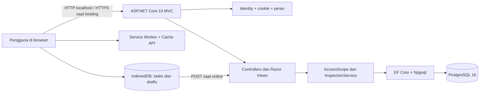
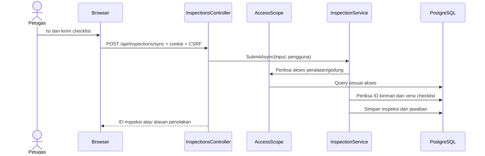
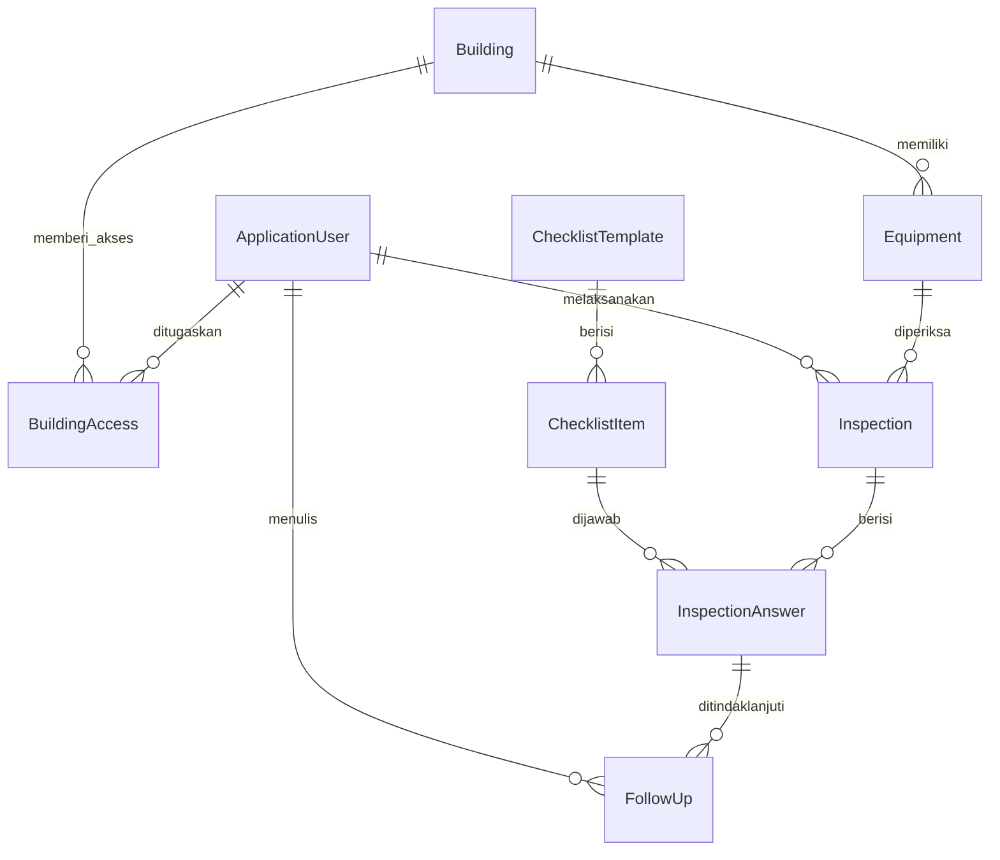
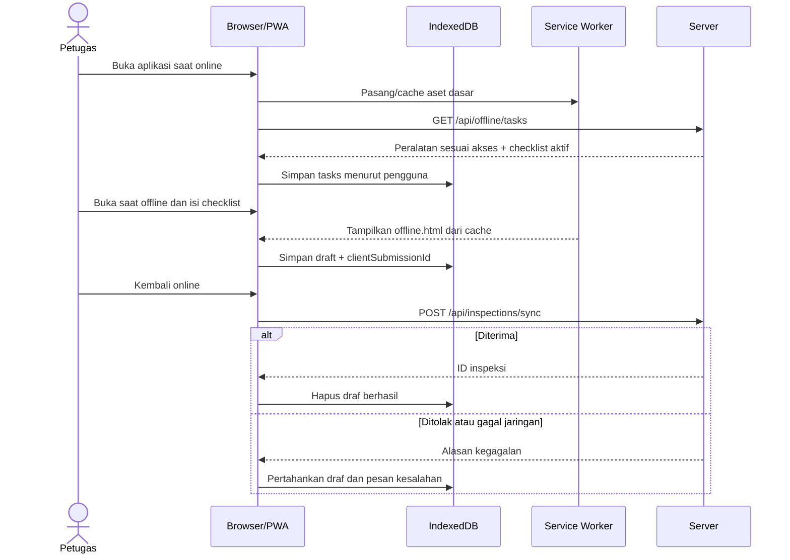

# Dokumentasi Implementasi dan Arsitektur Rescue Checklist

**Status:** aplikasi sampel lokal yang dapat dijalankan, bukan aplikasi operasional production.

**Acuan kebutuhan:** [SAMPLE_APP_RESCUE_CHECKLIST_AZURE.md](docs/SAMPLE_APP_RESCUE_CHECKLIST_AZURE.md).

**Petunjuk singkat:** [README.md](README.md).

## 1. Ringkasan

Rescue Checklist adalah aplikasi web untuk mencatat pemeriksaan peralatan rescue per gedung. Pengguna masuk dengan akun internal, melihat peralatan sesuai akses gedung, mengisi checklist, meninjau riwayat, menangani temuan, dan mengunduh laporan CSV. Aplikasi juga menyediakan PWA: data tugas yang telah diunduh dapat dipakai untuk membuat draf saat offline, lalu draf dikirim ketika koneksi tersedia kembali.

Proyek ini dibuat sebagai **satu aplikasi ASP.NET Core MVC**. Halaman dirender dengan Razor Views; endpoint JSON untuk sinkronisasi berada pada server yang sama. Data utama disimpan di PostgreSQL 16 melalui Entity Framework Core. Browser menyimpan aset dasar di Cache API dan data tugas serta draf di IndexedDB.

### Yang sudah dibuat

| Area | Implementasi |
| --- | --- |
| Autentikasi | Login/logout dengan ASP.NET Core Identity dan cookie, empat peran, akun demo lokal. |
| Otorisasi | Pemeriksaan peran dan pembatasan gedung pada query server. |
| Administrasi | Membuat gedung, peralatan, template checklist, dan pengguna; mengaktifkan/nonaktifkan data; mengubah peran serta akses gedung. |
| Inspeksi | Form checklist, validasi butir wajib dan catatan temuan, riwayat serta detail hasil. |
| Tindak lanjut | PIC Building dan Admin dapat menambah catatan serta status untuk temuan pada gedung yang dapat diakses. |
| Laporan | Ringkasan inspeksi dan temuan per gedung/periode, ekspor CSV dengan filter yang sama. |
| PWA/offline | Manifest, ikon instalasi, service worker, halaman offline, draf IndexedDB, sinkronisasi manual/otomatis dan pencegahan duplikat. |
| Database dan uji | Migrasi awal PostgreSQL, data fiktif, Docker Compose, skrip start lokal, empat test xUnit. |

## 2. Arsitektur sistem



### Tanggung jawab komponen

1. **Razor Views** menghasilkan tampilan responsif dengan Bootstrap 5 lokal dan CSS aplikasi. JavaScript biasa menangani draf serta status koneksi; tidak ada frontend SPA terpisah.
2. **Controllers** menerima permintaan halaman, form, dan JSON. Atribut `[Authorize]` membatasi akses berdasarkan login/peran.
3. **`AccessScope`** membuat query gedung, peralatan, dan inspeksi yang hanya mencakup gedung yang ditugaskan. Admin dapat melihat semua gedung.
4. **`InspectionService`** memvalidasi kiriman inspeksi dari form maupun endpoint sinkronisasi. Ini menjaga aturan bisnis tetap sama untuk kedua jalur.
5. **`ApplicationDbContext`** menggabungkan tabel Identity dan tabel aplikasi, mendefinisikan relasi serta indeks unik.
6. **PostgreSQL** menyimpan data resmi yang telah terkirim. **IndexedDB** menyimpan data tugas dan draf lokal; data ini belum menjadi hasil inspeksi resmi sebelum server menerimanya.

### Alur permintaan server



## 3. Struktur proyek

```text
RescueChecklist/
├── RescueChecklist.slnx
├── compose.yaml                 # PostgreSQL 16 lokal
├── start-local.ps1              # Kredensial lokal, Docker, dan web
├── .env.example                 # Contoh variabel, tanpa sandi aktif
├── README.md
├── DOKUMENTASI_ARSITEKTUR.md
├── src/RescueChecklist.Web/
│   ├── Program.cs               # Registrasi layanan dan middleware
│   ├── Controllers/             # Halaman, tindakan, JSON API
│   ├── Data/                    # DbContext dan seed demo
│   ├── Migrations/              # Migrasi PostgreSQL awal
│   ├── Models/                  # Entitas dan peran
│   ├── Services/                # Batas akses dan validasi inspeksi
│   ├── Views/                   # Halaman Razor
│   └── wwwroot/                 # CSS, JS, ikon, manifest, service worker
└── tests/RescueChecklist.Tests/ # xUnit
```

Paket inti web memakai target `net10.0`, `Microsoft.AspNetCore.Identity.EntityFrameworkCore` 10.0.15, `Microsoft.EntityFrameworkCore.Design` 10.0.15, dan `Npgsql.EntityFrameworkCore.PostgreSQL` 10.0.0. Bootstrap 5.3.8 disimpan sebagai file lokal di `wwwroot/lib/bootstrap` sehingga gaya dasar tersedia saat offline. Proyek test memakai xUnit, SQLite dalam memori untuk aturan bisnis, dan `WebApplicationFactory` untuk pemeriksaan redirect anonim.

## 4. Model data



| Entitas | Fungsi dan atribut penting |
| --- | --- |
| `ApplicationUser` | Akun Identity, `DisplayName`, `IsActive`; peran disimpan pada tabel Identity. |
| `Building` | Gedung/lokasi, kode unik, nama, status aktif. |
| `BuildingAccess` | Pasangan `UserId` + `BuildingId` sebagai penugasan gedung; kunci komposit. |
| `Equipment` | Peralatan pada satu gedung, kode unik, nama, status aktif. |
| `ChecklistTemplate` | Nama, nomor versi, status aktif. Pembuatan template baru menonaktifkan template aktif sebelumnya. |
| `ChecklistItem` | Urutan, pertanyaan, penanda wajib. Seed contoh berisi tiga butir wajib. |
| `Inspection` | Peralatan, pelaksana, waktu mulai/kirim UTC, versi template, status `Terkirim`, dan `ClientSubmissionId` unik. |
| `InspectionAnswer` | Satu jawaban per butir inspeksi: `Baik`, `PerluTindakan`, atau `TidakBerlaku`, dengan catatan opsional atau wajib sesuai kondisi. |
| `FollowUp` | Catatan, status `Terbuka`/`DalamProses`/`Selesai`, penulis, dan waktu UTC. Catatan baru ditambahkan tanpa mengubah jawaban asli. |

Indeks unik melindungi kode gedung, kode peralatan, pasangan nama-versi template, pasangan inspeksi-butir, dan `ClientSubmissionId`. Migrasi awal berada di `src/RescueChecklist.Web/Migrations/20261113093703_InitialPostgres.cs`.

## 5. Pengguna dan hak akses

| Aksi | Admin | PICBuilding | Rescue | Management |
| --- | :---: | :---: | :---: | :---: |
| Kelola pengguna, peran, gedung, peralatan, checklist | Ya | — | — | — |
| Lihat peralatan dan riwayat | Semua gedung | Gedung tugas | Gedung tugas | Gedung tugas |
| Kirim inspeksi | Ya | — | Ya | — |
| Catat tindak lanjut | Ya | Gedung tugas | — | — |
| Lihat laporan dan ekspor CSV | Semua gedung | Gedung tugas | — | Gedung tugas |

Halaman pribadi memakai `[Authorize]`. Pengguna tanpa sesi diarahkan ke login. Halaman Admin, FollowUps, Reports, dan tindakan pembuatan inspeksi memiliki batas peran tersendiri. Selain memeriksa peran, controller memakai `AccessScope` pada permintaan yang membaca atau mengubah data gedung, sehingga mengganti ID pada URL/form tidak memberi akses ke gedung lain. Akun yang dinonaktifkan ditolak saat cookie divalidasi. Setelah admin mengubah peran, pengguna terkait sebaiknya login ulang agar klaim peran dalam cookie diperbarui.

## 6. Halaman dan endpoint

| Metode dan rute | Fungsi | Akses |
| --- | --- | --- |
| `GET /Account/Login`, `POST /Account/Login` | Masuk dengan akun internal | Publik |
| `POST /Account/Logout` | Keluar | Login |
| `GET /` | Dashboard jumlah peralatan, inspeksi, dan temuan terbuka | Login |
| `GET /Equipment` | Daftar peralatan dengan cari dan filter gedung | Login, sesuai gedung |
| `GET /Inspections` | Riwayat dengan filter gedung/tanggal | Login, sesuai gedung |
| `GET /Inspections/Details/{id}` | Detail pelaksana, jawaban, waktu, versi, tindak lanjut | Login, sesuai gedung |
| `GET /Inspections/Create?equipmentId={id}` | Form inspeksi | Admin, Rescue |
| `POST /Inspections` | Jalur form server untuk pengiriman online | Admin, Rescue |
| `POST /api/inspections/sync` | Kirim satu draf JSON secara idempoten | Admin, Rescue |
| `GET /api/offline/tasks` | Unduh peralatan dan template aktif yang diizinkan | Login |
| `GET /FollowUps`, `POST /FollowUps/Create` | Lihat temuan dan tambah catatan/status | Admin, PICBuilding |
| `GET /Reports`, `GET /Reports/Export.csv` | Ringkasan dan CSV dengan filter sama | Admin, PICBuilding, Management |
| `GET /Admin`, `POST /Admin/*` | Pengelolaan data dan akses | Admin |

Form inspeksi di browser saat ini dicegat oleh `site.js`: draf disimpan dahulu di IndexedDB, lalu dikirim ke endpoint JSON. Jalur `POST /Inspections` tetap tersedia sebagai tindakan MVC server. Semua POST dilindungi antiforgery; permintaan JSON mengirim token melalui header `RequestVerificationToken` bersama cookie sesi.

## 7. Aturan inspeksi

Sebelum menyimpan, server memeriksa peran, identitas pengguna, ID kiriman, status dan akses peralatan/gedung, template aktif beserta versinya, daftar ID butir, pengisian butir wajib, serta nilai jawaban. Jawaban `PerluTindakan` wajib memiliki catatan. Catatan dibatasi 1.000 karakter. Hasil yang sudah terkirim ditampilkan sebagai riwayat dan tidak memiliki fitur edit langsung.

`ClientSubmissionId` dibuat di browser sebagai UUID. Jika ID yang sama dikirim ulang oleh pengguna yang sama, server mengembalikan inspeksi yang sudah ada. Indeks unik pada database menjadi pengaman tambahan terhadap duplikasi. Bila ID tersebut milik pengguna lain, kiriman ditolak sebagai konflik. Bila versi template sudah berubah, server mengembalikan konflik dan draf lokal tetap tersimpan agar dapat diperiksa kembali.

Waktu inspeksi dan tindak lanjut disimpan dalam UTC. Filter tanggal laporan/riwayat diperlakukan sebagai rentang tanggal UTC. Dashboard menghitung temuan terbuka dari status tindak lanjut terbaru; laporan menghitung jumlah jawaban `PerluTindakan` menurut gedung.

## 8. Alur PWA dan offline



- `sw.js` hanya menyimpan **app shell**: halaman offline, CSS, JS, manifest, dan ikon. Navigasi pribadi serta respons API tidak dimasukkan ke cache umum. Bila navigasi gagal karena jaringan, service worker menampilkan `offline.html`.
- IndexedDB `rescue-checklist-v1` memiliki object store `tasks` (kunci nama pengguna) dan `drafts` (kunci `clientSubmissionId`). Data tugas diunduh setelah pengguna membuka aplikasi saat online.
- Halaman offline menampilkan peralatan dan butir checklist yang sudah diunduh, memungkinkan petugas menyimpan draf dan melihat jumlah draf tersisa setelah reload. Saat jaringan kembali, halaman membuka aplikasi online agar antrean dapat disinkronkan.
- Pada halaman online, sinkronisasi berjalan saat aplikasi dibuka dan saat event `online`; tersedia pula tombol **Sinkronkan sekarang**. Kegagalan tidak menghapus draf, dan status menampilkan alasan yang tersedia.
- Tombol keluar meminta konfirmasi, menghapus store `tasks` dan `drafts`, lalu mengirim logout server. Kata sandi dan token jangka panjang tidak disimpan di IndexedDB atau Cache API.

Penggunaan offline mensyaratkan kunjungan online lebih dahulu pada browser/perangkat yang sama. Halaman offline tidak memverifikasi ulang identitas ke server ketika jaringan terputus; kebijakan perangkat bersama dan masa berlaku data lokal harus diputuskan sebelum pemakaian nyata.

## 9. Konfigurasi dan menjalankan lokal

Prasyarat: .NET SDK 10, Docker Desktop dengan Linux containers, PowerShell, dan browser modern. Jalankan dari folder proyek:

```powershell
.\start-local.ps1
```

Skrip membuat `.env` lokal bila belum ada, menghasilkan kata sandi acak PostgreSQL dan akun demo, mengatur environment variable proses, menjalankan `docker compose up -d`, menunggu PostgreSQL siap, lalu memulai web pada `http://localhost:5137`. File `.env` diabaikan Git. Volume `rescue_pgdata` mempertahankan database antarjalankan; container PostgreSQL memetakan `127.0.0.1:5433` ke port 5432 di dalam container.

`Program.cs` membutuhkan `ConnectionStrings__DefaultConnection`. Dalam environment `Development`, startup menjalankan `Database.MigrateAsync()` dan seed demo. Di environment lain, migrasi serta seed tidak dijalankan otomatis; proses rilis harus mengelolanya secara terpisah. Konfigurasi tanpa rahasia berada di `appsettings.json`. HTTPS dan HSTS diaktifkan pada environment selain `Development`; HTTP localhost dipakai untuk kemudahan uji lokal.

Seed awal mencakup **Gedung Contoh A**, tiga peralatan (`EQ-001` sampai `EQ-003`), satu template dengan tiga butir, serta akun `admin`, `pic`, `rescue`, dan `management` bila `RESCUE_DEMO_PASSWORD` tersedia. Akun non-Admin mendapat akses ke gedung contoh. Kata sandi aktif tidak ditulis di repositori; lihat `.env` lokal atau keluaran skrip. Mengganti nilai sandi dalam `.env` tidak otomatis mengganti hash sandi akun yang sudah tersimpan.

Untuk menghentikan database tanpa menghapus datanya:

```powershell
docker compose down
```

## 10. Pengujian dan verifikasi

Jalankan test otomatis dari folder proyek:

```powershell
dotnet test RescueChecklist.slnx
```

Empat test xUnit yang tersedia memeriksa: redirect pengunjung anonim dari halaman pribadi, pembatasan peralatan di luar gedung tugas, kewajiban catatan temuan dan idempotensi pengiriman, serta penolakan peran PIC/konflik versi template. Test aturan bisnis memakai SQLite dalam memori sehingga tidak mengubah database demo; test redirect memakai `WebApplicationFactory`.

Pada verifikasi lokal saat proyek dibuat, build selesai tanpa error, keempat test lulus, PostgreSQL sehat, dan halaman login merespons HTTP 200. Uji alur HTTP juga mencakup login empat peran, pengiriman inspeksi, pengiriman ulang dengan ID sama, tindak lanjut PIC, laporan dan CSV Management, serta penolakan tindakan tulis Management. Uji browser mencakup tampilan ponsel 375 px, halaman offline, draf yang tetap ada setelah reload, dan sinkronisasi satu kali setelah koneksi pulih.

## 11. Keamanan dan batas sampel

Yang sudah diterapkan: autentikasi Identity, otorisasi peran, pembatasan gedung di server, validasi server, perlindungan CSRF untuk POST termasuk JSON, cookie `HttpOnly`, cookie aman pada environment selain Development, indeks unik ID kiriman, pengecekan akun aktif, serta escaping CSV untuk nilai gedung yang dapat dibaca spreadsheet sebagai formula.

Beberapa keputusan masih bersifat sampel dan perlu validasi sebelum produksi:

1. Butir checklist, daftar peralatan, dan hak akses adalah data/rancangan fiktif karena BRD resmi belum tersedia dalam proyek ini.
2. Hanya satu template aktif dipakai secara global; belum ada pemetaan jenis template per kategori peralatan.
3. Belum ada SSO, foto, tanda tangan, notifikasi, PDF, audit trail khusus, prosedur koreksi hasil, atau migrasi data MSSQL lama.
4. Draf lokal berada pada perangkat/browser; belum ada kebijakan retensi, perangkat bersama, enkripsi khusus IndexedDB, atau pemulihan draf lintas perangkat.
5. Sinkronisasi memakai event koneksi dan tombol manual. Tidak ada jaminan background sync ketika browser tertutup.
6. Laporan sampel memuat hasil yang sesuai filter lalu mengelompokkan di memori; untuk volume besar, agregasi perlu dipindahkan ke query database dan paginasi/retensi perlu dirancang.
7. Deployment Azure, domain, WAF, jaringan privat, backup, pemantauan, dan pengelolaan rahasia production belum dibuat.

Untuk tahap Azure berikutnya, aplikasi dapat dibangun menuju Azure App Service dan dihubungkan ke Azure Database for PostgreSQL melalui konfigurasi rahasia yang disetujui. Migrasi database production perlu ditinjau dan dijalankan melalui proses deployment, bukan dengan mengandalkan seed lokal.
