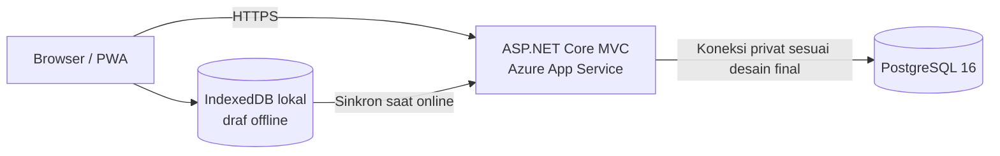

# Spesifikasi aplikasi sampel — Rescue Checklist PWA

## 1. Tujuan dokumen

Dokumen ini adalah acuan untuk **menulis kode aplikasi sampel dari nol** untuk pemeriksaan peralatan rescue berbasis web dan PWA. Sampel harus dapat dijalankan secara lokal dengan data tiruan, lalu dapat disiapkan untuk uji di Azure tanpa bergantung pada layanan POC lama. Dokumen ini bukan laporan bahwa aplikasi atau lingkungan production sudah tersedia.

**Sumber konteks:** email `Fw_ POC Azure.eml`, terutama uraian kebutuhan tanggal 6 Oktober 2026. Email tersebut membahas proyek Rescue Checklist; berkas lain di folder kerja ini membahas LMS Moodle dan bukan sumber fitur aplikasi ini. BRD yang dirujuk melalui tautan intranet di email tidak tersedia di folder ini, sehingga rincian formulir dan aturan inspeksi di bawah adalah rancangan sampel yang perlu divalidasi.

## 2. Fakta dari email dan keputusan untuk sampel

| Topik | Tercantum dalam email | Keputusan untuk aplikasi sampel |
| --- | --- | --- |
| Pengguna | Admin, PIC Building, Petugas Rescue; akses juga disebut untuk Management | Empat peran: `Admin`, `PICBuilding`, `Rescue`, `Management`. Hak akses rinci di §4 adalah usulan. |
| Akses | Melalui internet publik dan HTTPS | Antarmuka responsif; seluruh akses server melalui HTTPS saat dipasang di Azure. |
| Teknologi | ASP.NET Core 8 MVC/Razor, Bootstrap, JavaScript, PWA, Entity Framework Core | Pertahankan pola MVC/Razor, Identity, EF Core, dan PWA. Untuk kode baru gunakan versi .NET 10 yang masih didukung; alasannya dijelaskan di bawah. |
| Login | Akun internal aplikasi, ASP.NET Core Identity, otorisasi berbasis peran | Akun demo lokal; belum ada integrasi SSO. |
| Data | PostgreSQL 16; estimasi migrasi awal 15 MB | Gunakan PostgreSQL 16 dengan data tiruan. Angka 15 MB bukan target data sampel atau bukti migrasi. |
| Fitur | Manajemen pengguna, checklist, riwayat inspeksi, laporan, akses offline, sinkronisasi | Bangun alur ujung ke ujung yang dibatasi pada satu jenis checklist contoh. |
| Hosting | Production di Azure, App Service bila memungkinkan | Siapkan konfigurasi untuk Azure App Service dan PostgreSQL terkelola; deployment nyata merupakan pekerjaan terpisah. |
| POC lama | POC memakai akun penyedia dan layanan lama direncanakan dihapus setelah kebutuhan data ditangani | Jangan memakai akun, database, domain, atau data POC lama untuk sampel. |

### Framework dan teknologi yang digunakan untuk coding POC

| Lapisan | Pilihan implementasi dari nol | Fungsi |
| --- | --- | --- |
| Bahasa dan runtime | C# pada **.NET SDK 10 LTS**, target `net10.0` | Kode server dan build. |
| Web framework | **ASP.NET Core 10 MVC** dengan Razor Views | Halaman, controller, routing, dan validasi form. |
| Login dan izin | **ASP.NET Core Identity 10** dengan cookie login dan roles | Akun internal, login/logout, dan otorisasi. Template `-au Individual` menyediakan UI login awal. |
| Akses data | **Entity Framework Core 10** + `Npgsql.EntityFrameworkCore.PostgreSQL` **10.x** | Model, query, dan migrasi PostgreSQL. |
| Database | **PostgreSQL 16** | Data pengguna, gedung, peralatan, template, inspeksi, dan tindak lanjut. |
| Tampilan | **Bootstrap 5**, HTML, CSS, JavaScript | Antarmuka responsif mobile/desktop. Tidak memakai React atau SPA terpisah. |
| PWA/offline | Web App Manifest, Service Worker, Cache API, IndexedDB | Instalasi PWA, aset offline, draf lokal, dan antrean sinkronisasi. |
| Pengujian | xUnit + ASP.NET Core integration tests | Aturan bisnis, otorisasi, endpoint sinkronisasi. |
| Lokal | Docker Compose untuk PostgreSQL; `dotnet run` untuk web | POC dapat diuji tanpa Azure. |
| Azure (tahap berikutnya) | Azure App Service + Azure Database for PostgreSQL | Kandidat hosting sesuai arah email. |

**Keputusan versi:** email tertanggal 6 Oktober 2026 menyebut **ASP.NET Core 8**. Pada tanggal penyusunan dokumen ini, 13 November 2026, [dukungan .NET 8 sudah berakhir pada 10 November 2026](https://dotnet.microsoft.com/en-us/platform/support/policy/dotnet-core). Karena tim akan mulai menulis kode dari nol, target utama POC ini adalah **.NET 10 LTS**, dengan pola aplikasi tetap sesuai email. [EF Core 10 menargetkan .NET 10](https://learn.microsoft.com/en-us/ef/core/what-is-new/index), dan [provider Npgsql 10 mendukung EF Core 10](https://www.npgsql.org/efcore/release-notes/10.0.html). Jika tujuan POC ternyata harus mereplikasi versi email secara persis, gunakan target alternatif `net8.0` beserta EF Core/Npgsql major 8 hanya untuk pembandingan sementara; keputusan tersebut perlu dicatat karena versi itu tidak lagi mendapat pembaruan keamanan. Gunakan patch stabil terbaru dalam major yang dipilih dan kunci versi paket saat kode POC dibuat.

**Bentuk proyek:** satu aplikasi ASP.NET Core MVC. Razor Views merender halaman, controller menangani aksi, dan endpoint JSON di aplikasi yang sama menangani sinkronisasi offline. Template login `Individual Accounts` memakai halaman Identity dari Razor Class Library; halaman utama tetap MVC/Razor Views. [Dokumentasi Identity MVC](https://learn.microsoft.com/en-us/aspnet/core/security/authentication/identity?view=aspnetcore-10.0) menjelaskan template tersebut.

## 3. Cakupan MVP

1. Login dan logout menggunakan akun internal.
2. Admin mengelola gedung/lokasi, peralatan, template checklist, dan akun pengguna.
3. PIC Building melihat peralatan di gedung tanggung jawabnya, meninjau inspeksi, dan memberi catatan tindak lanjut.
4. Petugas Rescue memilih gedung dan peralatan, mengisi checklist, menambahkan catatan, lalu mengirim inspeksi.
5. Management melihat ringkasan dan mengunduh laporan CSV tanpa mengubah hasil inspeksi.
6. Riwayat inspeksi menyimpan waktu, pelaksana, jawaban, kondisi, dan status sinkronisasi.
7. PWA dapat dipasang di perangkat. Petugas yang sudah login dan sudah mengunduh data tugasnya dapat mengisi draf saat offline. Draf dikirim ketika koneksi kembali tersedia.

**Di luar MVP:** migrasi data MSSQL yang sebenarnya, integrasi sistem KPC lainnya, SSO, notifikasi, unggah foto, tanda tangan digital, dan pembuatan dokumen PDF. Tautan BRD dalam email perlu ditinjau sebelum cakupan final ditetapkan.

## 4. Peran dan hak akses usulan

| Aksi | Admin | PIC Building | Rescue | Management |
| --- | :---: | :---: | :---: | :---: |
| Kelola pengguna dan peran | ✓ |  |  |  |
| Kelola gedung, peralatan, template | ✓ |  |  |  |
| Lihat peralatan/inspeksi pada gedung terkait | ✓ | ✓ | ✓ | ✓ |
| Buat dan kirim inspeksi | ✓ |  | ✓ |  |
| Tambah catatan tindak lanjut | ✓ | ✓ |  |  |
| Lihat ringkasan dan ekspor CSV | ✓ | ✓ (gedung terkait) |  | ✓ |

Email juga memakai istilah `Supervisor` pada diagram login. Dalam sampel ini `PICBuilding` **diasumsikan** sebagai peran supervisor untuk gedungnya; penyamaan istilah tersebut harus dikonfirmasi. Pembatasan gedung diterapkan di server pada setiap permintaan, bukan hanya dengan menyembunyikan menu.

## 5. Alur utama

1. Admin membuat satu gedung, beberapa peralatan rescue, dan template checklist aktif.
2. Admin memberi PIC Building akses ke gedung tersebut dan membuat akun Petugas Rescue.
3. Petugas login, membuka daftar peralatan, lalu memilih **Mulai inspeksi**.
4. Untuk setiap butir, petugas memilih `Baik`, `Perlu tindakan`, atau `Tidak berlaku`; catatan wajib jika memilih `Perlu tindakan`.
5. Petugas menyimpan draf atau mengirim inspeksi. Hasil terkirim tidak dapat diubah langsung; koreksi dilakukan melalui inspeksi baru atau prosedur koreksi yang kelak disepakati.
6. PIC Building membuka hasil, menambahkan catatan tindak lanjut, dan melihat item yang perlu tindakan.
7. Management melihat jumlah inspeksi dan temuan per gedung/periode, lalu mengunduh CSV.

### Alur offline

1. Saat online, aplikasi mengunduh aset PWA serta daftar gedung, peralatan, dan template yang diizinkan untuk pengguna tersebut.
2. Saat offline, pengguna dapat membuka data yang sudah diunduh dan menyimpan **draf inspeksi** di IndexedDB pada perangkat yang sama. Antarmuka menampilkan label `Belum tersinkron`.
3. Ketika online kembali, aplikasi mencoba mengirim antrean. Sediakan juga tombol **Sinkronkan sekarang**, karena dukungan background sync berbeda antarperamban.
4. Setiap kiriman memakai `clientSubmissionId` unik. Server menyimpan ID tersebut agar pengiriman ulang tidak menggandakan inspeksi.
5. Server memeriksa ulang login, peran, gedung, dan versi template. Jika ditolak atau ada konflik, draf tetap tersimpan lokal dengan pesan yang dapat ditindaklanjuti; jangan menghapusnya diam-diam.
6. Data lokal dihapus saat pengguna memilih logout dan mengonfirmasi penghapusan draf lokal. Jangan menyimpan kata sandi atau token jangka panjang di cache PWA.

Service Worker menangani cache **app shell** (HTML dasar, CSS, JavaScript, ikon). IndexedDB menangani data tugas dan antrean draf. Halaman pribadi dan respons API tidak dimasukkan ke cache umum tanpa aturan khusus.

## 6. Layar yang dibuat

| Layar | Isi minimum |
| --- | --- |
| Login | Username, password, pesan kesalahan, informasi koneksi. |
| Dashboard | Ringkasan peralatan, inspeksi terbaru, temuan terbuka, status sinkronisasi. |
| Gedung dan peralatan | Daftar, pencarian sederhana, detail peralatan, tindakan mulai inspeksi. |
| Form inspeksi | Identitas peralatan, butir checklist, pilihan kondisi, catatan, simpan draf, kirim. |
| Riwayat | Filter tanggal/gedung/status, detail jawaban dan pelaksana. |
| Tindak lanjut | Daftar temuan dan catatan PIC Building. |
| Laporan | Filter periode dan gedung, tabel ringkasan, ekspor CSV. |
| Administrasi | Pengguna/peran, gedung, peralatan, template dan butir checklist. |
| Status offline | Jumlah draf tertunda, status kiriman terakhir, tombol sinkronkan. |

Tampilan perlu nyaman digunakan pada ponsel dan desktop. Status offline, kesalahan validasi, serta hasil sinkronisasi harus terbaca jelas tanpa hanya mengandalkan warna.

## 7. Model data minimum (usulan)

| Entitas | Kolom penting | Keterangan |
| --- | --- | --- |
| `ApplicationUser` | `Id`, `UserName`, `DisplayName`, `IsActive` | Tabel Identity untuk autentikasi; relasi peran memakai ASP.NET Core Identity. |
| `Building` | `Id`, `Code`, `Name`, `IsActive` | Gedung/lokasi inspeksi. |
| `BuildingAccess` | `UserId`, `BuildingId` | Ruang lingkup akses PIC dan petugas. |
| `Equipment` | `Id`, `BuildingId`, `Code`, `Name`, `IsActive` | Peralatan yang diperiksa. |
| `ChecklistTemplate` | `Id`, `Name`, `Version`, `IsActive` | Versi yang digunakan pada inspeksi harus tercatat. |
| `ChecklistItem` | `Id`, `TemplateId`, `Order`, `Question`, `IsRequired` | Butir checklist. |
| `Inspection` | `Id`, `ClientSubmissionId`, `EquipmentId`, `TemplateVersion`, `InspectorUserId`, `StartedAt`, `SubmittedAt`, `Status` | Satu hasil pemeriksaan; `ClientSubmissionId` unik. Waktu disimpan dalam UTC. |
| `InspectionAnswer` | `Id`, `InspectionId`, `ChecklistItemId`, `Result`, `Note` | `Result`: `Baik`, `PerluTindakan`, `TidakBerlaku`. |
| `FollowUp` | `Id`, `InspectionAnswerId`, `AuthorUserId`, `Note`, `Status`, `CreatedAt` | Catatan dan status tindak lanjut. |

Gunakan migrasi EF Core yang dapat dijalankan ulang secara aman pada database kosong. Data contoh berisi gedung, peralatan, template, dan pengguna **fiktif**; jangan menyalin data operasional atau kredensial dari email.

## 8. Struktur aplikasi yang disarankan

```text
RescueChecklist/
├── RescueChecklist.slnx
├── src/
│   └── RescueChecklist.Web/
│       ├── Controllers/
│       ├── Data/                 # DbContext, konfigurasi EF, migrasi, seed demo
│       ├── Areas/Identity/       # Hanya jika UI Identity perlu dikustomisasi
│       ├── Models/               # Entitas dan view model
│       ├── Services/             # Inspeksi, laporan, sinkronisasi
│       ├── Views/                # Razor Views
│       └── wwwroot/              # CSS/JS, manifest, service worker, ikon
├── tests/
│   └── RescueChecklist.Tests/
├── compose.yaml                  # PostgreSQL lokal
└── README.md
```

**Komponen:** gunakan versi pada tabel framework di §2. Controller MVC menangani halaman; endpoint JSON khusus dipakai untuk menyinkronkan draf. Satu `ApplicationDbContext` berbasis `IdentityDbContext<ApplicationUser>` mengelola tabel Identity dan tabel aplikasi, memakai provider PostgreSQL.

### Endpoint yang diperlukan

| Method dan rute contoh | Fungsi | Peran |
| --- | --- | --- |
| `GET /` | Dashboard | Semua pengguna login |
| `GET /Equipment` | Daftar peralatan sesuai akses gedung | Semua pengguna login |
| `GET /Inspections/Create?equipmentId=...` | Form inspeksi | Admin, Rescue |
| `POST /Inspections` | Kirim inspeksi online dengan validasi server | Admin, Rescue |
| `POST /api/inspections/sync` | Kirim satu draf offline secara idempoten | Admin, Rescue |
| `GET /Inspections` | Riwayat sesuai akses | Admin, PIC Building, Rescue, Management |
| `POST /FollowUps` | Catatan tindak lanjut | Admin, PIC Building |
| `GET /Reports` | Ringkasan | Admin, PIC Building, Management |
| `GET /Reports/Export.csv` | Ekspor berdasarkan filter yang sama | Admin, PIC Building, Management |

Admin boleh memakai halaman MVC untuk CRUD. Semua POST memakai perlindungan CSRF yang sesuai, termasuk endpoint sinkronisasi berbasis cookie. Validasi dan otorisasi berlaku di server untuk tiap operasi.

## 9. Memulai coding POC dari nol

### Prasyarat pengembang

Pasang .NET SDK 10, Docker dengan Compose, editor C#, dan browser dengan DevTools. Sediakan akses NuGet saat instalasi awal paket. Tidak diperlukan akun Azure untuk tahap lokal.

### Membuat proyek awal

Jalankan perintah berikut dari folder baru `RescueChecklist` (PowerShell). Contoh ini membuat aplikasi MVC dengan login bawaan. [Template Identity](https://learn.microsoft.com/en-us/aspnet/core/security/authentication/identity?view=aspnetcore-10.0) memakai SQLite secara awal, sehingga provider dan migrasinya perlu diganti sebelum membuat database PostgreSQL.

```powershell
dotnet new sln --name RescueChecklist
dotnet new mvc --name RescueChecklist.Web --output src/RescueChecklist.Web --framework net10.0 --auth Individual
dotnet sln RescueChecklist.slnx add src/RescueChecklist.Web/RescueChecklist.Web.csproj
dotnet package remove Microsoft.EntityFrameworkCore.Sqlite --project src/RescueChecklist.Web/RescueChecklist.Web.csproj
dotnet package add Npgsql.EntityFrameworkCore.PostgreSQL --version "10.*" --project src/RescueChecklist.Web/RescueChecklist.Web.csproj
dotnet package add Microsoft.EntityFrameworkCore.Design --version "10.*" --project src/RescueChecklist.Web/RescueChecklist.Web.csproj
dotnet new tool-manifest
dotnet tool install --local dotnet-ef --version "10.*"
```

Setelah restore, ganti versi mengambang `10.*` dalam `.csproj` dan manifest tool menjadi nomor patch stabil yang terpasang agar build berikutnya konsisten. Buat `ApplicationUser`, ubah `ApplicationDbContext` menjadi `IdentityDbContext<ApplicationUser>`, lalu ganti registrasi SQLite dan `IdentityUser` bawaan template di `Program.cs` dengan registrasi berikut (sesuaikan nama kelas/namespace):

```csharp
builder.Services.AddDbContext<ApplicationDbContext>(options =>
    options.UseNpgsql(builder.Configuration.GetConnectionString("DefaultConnection")));

builder.Services.AddDefaultIdentity<ApplicationUser>(options =>
    options.SignIn.RequireConfirmedAccount = false)
    .AddRoles<IdentityRole>()
    .AddEntityFrameworkStores<ApplicationDbContext>();
```

Set `RequireConfirmedAccount = false` hanya untuk akun demo lokal tanpa alur email konfirmasi; tentukan kebijakan akun production sebelum deployment. Hapus migrasi SQLite bawaan template **di proyek baru tersebut** sebelum membuat migrasi awal PostgreSQL. Tambahkan entitas di §7, relasi, indeks unik `ClientSubmissionId`, serta seed data fiktif. [Panduan Npgsql untuk EF Core](https://www.npgsql.org/efcore/) menunjukkan konfigurasi `UseNpgsql`.

### Database lokal dan menjalankan aplikasi

Sediakan `compose.yaml` untuk PostgreSQL 16 dan instruksi di `README.md` aplikasi. Simpan pengaturan non-rahasia di `appsettings.Development.json`; connection string dan sandi demo di environment variable atau .NET user secrets. Berikan `.env.example` yang hanya berisi placeholder. Setelah model dan `DbContext` selesai, jalankan:

```powershell
docker compose up -d
dotnet tool restore
dotnet ef migrations add InitialPostgres --project src/RescueChecklist.Web --startup-project src/RescueChecklist.Web
dotnet ef database update --project src/RescueChecklist.Web --startup-project src/RescueChecklist.Web
dotnet run --project src/RescueChecklist.Web
```

Perintah migrasi tersebut ditujukan untuk database **lokal POC**; [Microsoft menjelaskan](https://learn.microsoft.com/en-us/ef/core/managing-schemas/migrations/applying) bahwa migrasi production perlu ditinjau dan diterapkan melalui proses deployment yang sesuai. Sebelum menjalankan migrasi, set `ConnectionStrings__DefaultConnection` ke PostgreSQL lokal dan pastikan kredensial seed demo hanya ada di lingkungan pengembangan.

Login dengan akun demo yang dibuat saat seed; README aplikasi menjelaskan cara membuat atau mereset akun tanpa menaruh sandi aktif di repositori. Uji alur inspeksi online, aktifkan mode offline di browser, buat draf, kembalikan koneksi, lalu periksa hasil sinkronisasi dan riwayat di PostgreSQL.

## 10. Rancangan penempatan di Azure

Untuk uji Azure, tempatkan aplikasi di **Azure App Service**, data di **Azure Database for PostgreSQL**, dan rahasia koneksi dalam mekanisme konfigurasi rahasia yang disetujui tim infrastruktur. Aktifkan HTTPS, log aplikasi, backup database, dan pembatasan akses database sesuai kebijakan KPC. Konfigurasi domain dan WAF memerlukan keputusan tim infrastruktur; email hanya menyebut rencana penyesuaian, bukan bukti bahwa komponen tersebut sudah aktif.

Diagram ringkas:



Sampel harus tetap dapat dijalankan tanpa akun Azure. Jangan men-deploy ke langganan, tenant, atau domain nyata berdasarkan dokumen ini saja.

## 11. Kriteria penerimaan sampel

- Pengguna tanpa login tidak dapat membuka halaman dan endpoint data.
- Peran dan pembatasan gedung diuji pada server, termasuk saat URL atau ID diganti manual.
- Admin dapat membuat satu gedung, satu peralatan, dan satu template dengan sedikitnya tiga butir.
- Petugas dapat mengirim inspeksi dengan semua butir wajib terisi; `Perlu tindakan` tanpa catatan ditolak.
- Riwayat menampilkan jawaban, pelaksana, waktu, dan versi template yang digunakan.
- PIC Building dapat menambahkan tindak lanjut hanya untuk gedung yang ditugaskan.
- Management dapat melihat ringkasan dan CSV, tetapi tidak dapat mengubah inspeksi.
- Aplikasi dapat dipasang sebagai PWA dan membuka halaman dasar saat offline setelah kunjungan online pertama.
- Draf yang dibuat offline tetap ada setelah halaman dimuat ulang dan tersinkron satu kali saat koneksi pulih; kiriman ulang dengan `clientSubmissionId` sama tidak membuat duplikat.
- Penolakan sinkronisasi tidak menghapus draf; pengguna melihat alasan kegagalannya.
- Migrasi dan seed berhasil pada database lokal kosong, tanpa akses ke POC Azure lama.

## 12. Hal yang perlu divalidasi sebelum aplikasi sesungguhnya

1. Isi BRD resmi: daftar peralatan, butir checklist, kriteria lulus/gagal, dan aturan tindak lanjut.
2. Apakah `PIC Building` sama dengan `Supervisor`, serta hak akses Management dan Rescue per gedung.
3. Apakah pengguna boleh membuat inspeksi offline tanpa login ulang, berapa lama draf boleh disimpan, dan kebijakan perangkat bersama.
4. Kebutuhan bukti foto, tanda tangan, audit trail, retensi data, serta format laporan resmi.
5. Detail migrasi MSSQL ke PostgreSQL dan siapa pemilik data sumber; angka 15 MB dalam email adalah estimasi, bukan spesifikasi migrasi lengkap.
6. Desain jaringan Azure, domain, WAF, backup, pemantauan, dan persetujuan deployment production.

## 13. Urutan pengerjaan

1. Buat proyek ASP.NET Core 10 MVC dari template `Individual Accounts`, ganti SQLite dengan PostgreSQL 16, buat migrasi, dan seed demo.
2. Implementasikan otorisasi peran dan gedung, lalu halaman administrasi minimum.
3. Implementasikan form inspeksi, validasi, riwayat, dan tindak lanjut.
4. Implementasikan ringkasan dan ekspor CSV.
5. Tambahkan manifest, Service Worker, penyimpanan draf IndexedDB, dan sinkronisasi idempoten.
6. Verifikasi kriteria penerimaan di §11, lalu siapkan konfigurasi Azure tanpa memakai resource POC lama.
